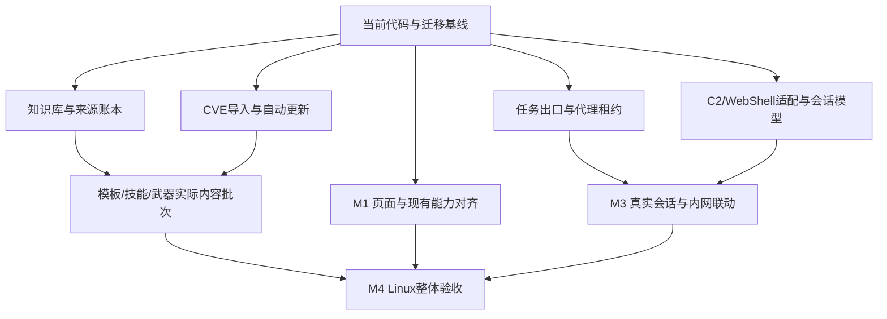

# ARTEX 截图对齐实现方案

状态：2026-11-11 需求访谈收敛，用户已同意最终澄清。本文保留需求及验收基线；当前产品实施、已交付内容和真实运行证据见[实施状态](screenshot-parity-status.md)及[Linux验收](screenshot-parity-linux-validation.md)。此基线不代表各项均已完成，父 issue #1 仍开放。

需求与证据来源见 [截图反推需求与设计](screenshot-parity-design.md)。本文件以其“当前范围覆盖规则”为准，不恢复已排除的自定义 Agent。

## 交付目标

在现有 Go + Next.js + PostgreSQL 上扩展，使用户提供截图中的页面结构、字段、导航和可见功能具备真实后端支持。保留当前配色、运行时 key、历史数据和已有报告、复测、证据、审批能力。

Linux 服务器为部署和验收环境，Docker Compose 为标准交付形式，保留 Linux 二进制启动方式。默认沿用现有并发、超时、Token 配置。所有界面计数来自实际数据。

明确排除：自定义 Agent 的新增、改造、提示词、资源绑定及专属自动触发；宣传中无法验证的数据快照和效果承诺。CVE、扫描模板、技能和武器库内容必须实际交付，不能仅有管理界面。只有目录名称的技能需要调研、设计、编写和验证，不能声称拿到原作者私有正文，也不能将内容一概推迟到用户提供后再做。

## 实际内容交付

实际内容与管理功能同时交付，不能将缺失内容全部留给用户提供。来源调查、补充编写、依赖安装、版本记录和验证属于实施工作。

| 内容 | 交付要求 | 来源与验证方式 |
| --- | --- | --- |
| CVE语料 | 实际全量公开元数据、离线索引、更新机制 | 核对官方来源、记录快照/提交标识；导入后统计、断网检索和更新重跑测试 |
| 扫描模板 | 实际 Nuclei 模板文件、索引、版本、更新、工具调用和执行记录 | 官方模板为首个内容来源，保留版本与兼容引擎；模板默认执行集合受任务配置及现有审批规则控制 |
| 技能 | 实际说明、工作流、所需脚本/工具依赖、输入输出与可验证结果 | 保留现有内容并补充有来源或项目自行编写的内容；按截图类别建立清单和隔离靶场测试，不以空目录计完成 |
| 武器库条目 | 实际可检索正文及适用条件、来源、相关CVE/产品、验证记录、检测与修复说明；适合授权测试的条目应有可验证复现材料或已有工具引用 | 区分公开漏洞知识、模板引用、可验证测试用例与私有内容，逐项记录版本/出处/验证范围；未经实测不标已验证，不承诺重建图中私有EXP集合 |

内容来源和可分发方式由代理研究，用户无需提供额外目标项目材料。上游内容、编写内容、运行工具、验证结果分开计数；公开 CVE 文本不能算作训练样本或已验证武器。武器库不得包含从截图抄录的真实目标凭据或未经处理的目标数据。

来源调研单独保存至 `screenshot-parity-content-sources.md`。该文件的创建和调研不等于已经下载或交付数据包。

每个内容发布批次生成机器可读清单：来源URL、版本/提交号、获取时间、文件数、内容哈希、许可信息、导入器/引擎版本、可用/禁用/验证通过/验证失败的实际数量。批次和单项记录都可追溯；原始材料与规范化索引分离，重建索引不要求再次联网下载。

技能与武器条目先按截图的Web、资产侦察、内网、云与容器、逆向/代码审计等分类建立具体内容清单，再逐项填充正文、依赖、输入输出和验证用例。可从公开资料获取的导入；需要项目工作流的自行编写；原始资料无法确认的不得抄名称充数。分类型标注已完成项及实际内容覆盖，不能用总条数掩盖某个类别为空。无来源正文不构成将整个类别排除出交付的理由。

## 页面与行为映射

| 页面 | 行为 | 数据来源与验收 |
| --- | --- | --- |
| 导航与顶栏 | 按截图重排工作台、作战、情报、执行、知识库、智能、安全、运维；保留旧链接重定向/兼容；显示真实出口与状态 | 不改变当前主题色；入口可达、刷新后保持当前页面；无配置显示明确未配置状态 |
| 仪表盘 | 快速目标输入、流程模板入口、任务/发现/资产/Token 聚合、CPU/内存 | 快速开始实际创建并进入任务；配置失效时显示具体原因；监控口径见 D26 |
| 漏洞发现 | 严重性切换、搜索、行展开、摘要 | 复用 findings 与证据关联；截图主列表结构对齐；原报告、复测等在详情保留 |
| 武器库（知识库） | 分类/类型/分档、已验证、匹配正文、搜索、摘要、全文、复用数 | 真实条目、来源、发布状态及验证记录；默认 Agent 检索只使用已发布、有效且已验证条目 |
| CVE 语料 | 总数、年份计数、搜索、手动更新、定时更新开关、导入进度、参考链接 | 全量公开元数据导入；首次导入后断网可查；不包含利用代码；REJECTED 等来源状态独立保留并明确默认展示策略 |
| 技能库 | 复用目录树和文件管理，增加分类标签、筛选和实际使用计数 | 分类与绑定均持久化；目录名不能代替有内容的技能；内容交付范围见 D25 |
| Agent | 原卡片、编辑与真实资源计数；内置名称/职责对齐 | goals/mainagent 等 key 不迁移；自定义卡片显示已有实际配置，不强制14张 |
| IP 代理池 | 代理导入/编辑、健康状态、任务租约、故障切换、出口显示 | HTTP/HTTPS/SOCKS5；任务租约与真实请求路径一致；失败按配置暂停或显式回退 |
| 内网作战 | 拓扑、任务筛选、主机/会话/隧道/凭据统计、心跳和会话入口 | 原生领域关系加真实适配器接入；未接入的操作显示不可用及原因；首个适配器见 D24 |
| C2 / WebShell 管理入口 | 按截图落实真实 C2 和 WebShell 管理：接入配置、会话列表、心跳、任务关联、凭据引用、拓扑关系及能力约束下的操作；图中 `http_phpcmd` 作为 HTTP/PHP 会话类型纳入适配器设计 | 仅有 SSH 不能通过验收；至少需要一个与截图同类的 HTTP/PHP WebShell 会话适配器在隔离靶场跑通，并以能力声明区分其他 C2 类型 |
| 规则、审批、日志等 | 保留既有能力并调整导航位置 | 历史记录和详情可用，无需重新配置已有规则 |

所有新增页面都要定义加载中、空数据、未配置、无搜索命中、部分失败、权限/凭据失效状态。图2的聊天软件遮挡层不属于产品复刻内容。没有截图的页面采用当前项目组件体系，按数据和任务需要补齐交互。

## 模块边界与实现落点

下列文件/目录是建议落点，尚未创建；工程实施可在不改变行为合同的前提下调整命名。

| 模块 | 建议位置 | 对外职责 |
| --- | --- | --- |
| 知识服务 | `knowledge/`、`db/knowledge*.go`、`server/knowledge.go` | 检索、全文、候选来源、版本、发布、验证状态和复用计量 |
| CVE 服务 | `cve/`、`db/cve*.go`、`server/cve.go` | 来源导入、更新任务、按年统计、离线搜索 |
| 代理资源服务 | `egress/`、`db/egress*.go`、`server/egress.go` | 代理端点、健康、租约和出口状态；与现有流量记录代理衔接 |
| 会话集成 | `connections/`、`db/connections*.go`、`server/connections.go` | 来源适配、状态、关联、心跳、操作能力和失效 |
| 系统指标 | `server/system_metrics.go` | Linux/容器指标采集、口径和时间戳 |
| 既有模块改造 | `agent/worker.go`、`agent/assembly.go`、`server/task_templates.go`、`web/src/navigation/sidebar/sidebar-items.ts` | 内置检索工具装配、内网变体选择、快速开始和导航 |
| UI/API类型 | `web/src/app/(main)/`、`web/src/lib/api.ts`、`web/src/lib/types.ts` | 页面、接口调用、共享类型及错误反馈 |

先用 PostgreSQL 的索引、全文检索和结构化过滤支持知识/CVE检索，中文产品名、别名及混合语言需求要通过具体用例验证；需要子串匹配时比较现有可用索引能力。暂不引入独立搜索服务或向量数据库，不能未验证就承诺延迟指标。

## 核心数据模型

### 知识库

- `knowledge_entries`：稳定 code、标题、摘要、分类、类型、分档、发布状态、验证状态、当前版本、来源类型、时间戳。
- `knowledge_versions`：条目版本、正文、内容摘要哈希、变更说明；旧版本可追溯。
- `knowledge_sources`：任务/发现/证据/导入文件来源关联；候选采集以来源标识和版本去重。
- `knowledge_verifications`：验证结论、对应内容版本、方法、证据引用与时间。正文实质变更不能继承旧版本验证通过状态。
- `knowledge_usage`：调用主体、任务/会话、条目版本、调用标识、时间与结果；重复提交同一调用标识不重复计数。

发布状态与验证状态分开：草稿可以具有验证证据，发布也不自动代表验证通过。撤销、失效或版本更新后立刻影响默认检索。任务专属凭据和原始敏感数据留在原受控证据中，跨任务条目只保存脱敏材料及授权范围允许的引用。

`kb_search` 返回匹配摘要和稳定 code；`kb_get(code)` 获取可访问版本全文，并按独立调用记录真实取用。列表浏览和搜索不增加复用数；复用数表示取用次数，不等于成功利用次数。对执行结果的评估另存字段，不能混成一个计数。

### CVE

- `cve_records`：CVE ID、来源状态、发布日期/更新时间、描述、厂商/产品、受影响版本原始结构、参考链接、来源版本、内容哈希。
- `cve_sync_runs`：来源、游标/快照标识、开始/完成时间、读取/新增/修改/失败数、状态与错误。
- 已完成的批次可查询，导入失败不清空旧数据；更新作业互斥，记录断点，提交与游标推进顺序保证可重跑。
- 来源数据的发布时间不能直接作为本地更新时间；不把搜索命中截断后的100条当作总命中数。

“快照”只表示首次全量导入的基线和每次更新的版本记录，不表示语料停止变化。CVE 持续自动同步新增和修改的数据，更新来源状态（包括撤回/REJECTED）及引用。该能力已在 D10 确认，不能因锁定基线而移除。

更新流程：首次全量导入 → 后台定时检查官方增量 → 幂等应用新增/修订/状态变化 → 刷新检索索引和年份统计 → 记录成功版本及下次检查。服务重启后从持久化游标恢复；错过增量窗口或游标不可用时，重新核对官方基线补齐差异，不清空当前可查询数据。

保留“立即更新”和自动更新开关，页面显示最近检查、最近成功、来源版本、新增/修改/失败条数及下次检查时间。断网或失败时继续使用本地库，按退避策略重试；恢复网络后补同步。关闭页面不影响后台更新。记录本身的版本与本地同步时间分开保存。

官方 baseline/delta 和 Git 更新方案已核对，见内容来源文档；具体选择由实现验证决定。定时频率、超时和重试参数可配置，不要求每次有新 CVE 都人工点击，也不把定时拉取描述为实时推送。默认频率在实现时明确并沿用已有用户配置。

### 代理池

- `proxy_endpoints`：协议、主机/端口、认证引用、启用状态、来源。
- `proxy_health`：最后检查、成功/失败、延迟、经确认的出口IP和检查有效期。
- `proxy_leases`：任务与代理的租约、状态、起止时间、故障切换原因。

区分目标流量出口、LLM 配置代理和 web search 代理。新池默认不改写后两者。启用录制时目标出口接在现有 MITM 上游；未录制时也必须使用同一任务出口选择规则。顶部无任务上下文时展示系统默认出口，任务页展示当前任务出口，避免混淆并发任务。

### 内网与会话

- 适配器配置和能力清单：来源类型、连接状态、版本、认证引用、支持操作。
- 会话：来源端ID、任务、资产/宿主、协议、运行状态、心跳、退出原因。
- 隧道：端点、方向、会话、状态；拓扑边来自实际连接关系，不能仅凭同一网段推断可达。
- 凭据引用：类型、资产/身份、适用范围、有效状态、来源；列表默认脱敏，普通日志不打印值。
- 操作记录：请求ID、会话版本、参数摘要、执行状态、证据/输出引用及错误。

现有资产ID作为关联基础，不重建冲突的资产库。会话断开、凭据失效、适配器不可达需要分别展示。worker_intranet 的选择检查任务归属、实际可用状态及适配器能力；失败时给出原因并按任务状态处理，不循环假设会话仍可用。

## 建议 API 合同

路由名称是草案，最终须与 `server/server.go` 现有前缀和认证约定对齐。

| 资源 | 操作 |
| --- | --- |
| knowledge | 搜索/详情、创建/编辑、导入、来源、验证记录、发布/撤销、使用记录 |
| cve | 搜索、详情、统计、同步状态、启动更新、更新设置 |
| egress | 代理列表/编辑/导入、检查、任务租约、出口状态 |
| connections | 适配器配置/状态、会话、拓扑、隧道、凭据元数据、能力约束下的操作与结果 |
| system metrics | 指标值、采样时间、采集范围、不可用原因 |
| task quick start | 预设模板、有效配置预览、幂等创建任务 |

列表接口分页，搜索和导入限制请求体大小。长任务返回作业ID并可查询进度；前端离开页面不取消后台导入。写接口沿用现有认证和错误约定。任务删除/归档时定义关联策略，不能让知识来源引用导致误删其他任务数据。

## 迁移、运行和回退

- 遵循现有启动幂等 schema 迁移机制，新增表/索引和可兼容字段；不批量重命名已有角色、不覆盖用户 Agent 提示词。
- 现有 global_proxy 作为兼容配置保留，未开启代理池时行为不变；显式启用池后才使用租约策略。
- 技能分类元数据新增时为缺失项显示“未分类”，不覆盖原始文件正文；分类存储方式以最小兼容改动选择。
- CVE和知识导入任务与业务任务并发限制分开，避免全量导入占满数据库连接或阻塞正在运行的任务。
- 凭据使用现有受控配置机制；如当前机制不满足新增会话密钥的保护需求，需要在实施时补充明确存储方案及迁移，而非散落明文到日志或页面。
- 备份包括 PostgreSQL、data、skills 和新增外部持久化材料；回退应用时新增数据不删除，旧应用忽略新增结构，真正数据库恢复用备份执行。

## 分期交付与验收

| 阶段 | 交付 | 必须通过的行为验收 |
| --- | --- | --- |
| M1 页面与已有能力对齐 | 导航/顶栏、漏洞列表、技能分类、Agent显示、快速开始、资源指标 | 旧任务/证据/报告可访问；快速开始真实建任务且继承限制；统计与数据库一致；截图结构逐项对照 |
| M2 知识、CVE与实际内容 | 知识管理/候选/发布/检索/计量、实际CVE语料、真实扫描模板、补充技能、武器库内容及版本更新 | 撤销及新版本立即影响检索；取用去重；正文变更不继承错误验证状态；导入重跑和离线检索；模板可被真实工具加载；技能有依赖与测试结果；武器条目有出处与验证状态，非空壳 |
| M3 代理与 C2/WebShell 会话 | 代理租约/健康/故障切换、原生拓扑/会话/隧道/凭据关系、HTTP/PHP WebShell 适配器、C2 能力声明、内网worker变体 | 多任务出口不串用；故障按设置暂停/切换；HTTP/PHP 会话真实心跳、断开、任务关联与受控操作反映到UI；无能力操作不可执行；变体选择正确 |
| M4 Linux整体验收 | Compose交付、集成靶场、升级/备份说明、全部页面验收表 | 一次从启动、任务、发现、经验候选、发布到检索复用的完整演练；重启后数据和状态恢复；回归已有审批、报告和复测 |

M1–M4 是实现顺序，不自动缩减总范围。C2/WebShell 是 M3 的必做专项：没有与截图同类的 HTTP/PHP WebShell 适配器及隔离靶场测试，不得标记 M3 完成；SSH 只能作为额外适配器。其他 C2 协议按能力声明和可用适配器逐项展示，不能用 SSH 或静态页面冒充。对截图未揭示行为只承诺已确认验收用例，不声称目标项目内部实现相同。

## 最终决策

| 决策 | 最终结果 | 状态 |
| --- | --- | --- |
| D24 首个实际接入 | 按截图落实 C2/WebShell 管理；图中 `http_phpcmd` 作为 HTTP/PHP WebShell 会话类型，首个适配器必须跑通接入、心跳、断开、任务关联、拓扑、凭据引用和受控操作；SSH仅为可选补充，不能替代 | 用户已明确；已将 C2/WebShell 设为 M3 必做 |
| D25 实际内容交付 | CVE语料、扫描模板、技能和武器库内容均在本期范围内；来源调研、下载/编写、依赖、版本、更新、索引及真实验证一起设计 | 用户已明确；推翻原范围缩减建议 |
| D26 资源监控口径 | Docker部署显示容器真实CPU/内存占用及限制，标明采集范围；二进制部署显示对应Linux进程指标；整机指标通过显式配置接入 | 用户已同意 |
| D27 分期与共同理解 | 以 M1–M4 为实施顺序，实际内容、C2/WebShell 和最终验收均保留；需求访谈结束 | 用户最终回复“同意”，当前无待用户决策项 |
| D28 内容版本与CVE自动更新 | 版本锁定用于追溯和回退；CVE以首次全量基线加后台定时增量持续更新，包含新增、修改及来源状态变化；模板、技能和武器库各自记录版本，不与CVE更新策略混为一谈 | 用户同意自动更新澄清；不将此扩展为可执行模板/脚本未经检查的静默更新 |

## 实施依赖与技术核验

以下属于工程调查与验证，不再要求用户提供截图中没有的信息。若结果实质改变已确认范围，应记录变更原因，不得静默删减功能。

| 技术核验 | 处理方式 | 完成证据 |
| --- | --- | --- |
| HTTP/PHP会话协议与首个C2来源 | 调查成熟工具及现有库，选择可复现接入；图中会话类型名不足以推出请求格式，不伪称兼容原作者私有协议 | 固定适配器版本、协议说明、实际连接及断连记录、截图操作矩阵 |
| 模板库许可与引擎兼容 | 核对确切快照及许可，锁定引擎，导入时校验模板 | 来源清单、许可记录、语法校验与实际加载记录 |
| 搜索索引与性能 | 在实际CVE规模、中文/英文混合知识条目和筛选条件下测量，不先引入额外搜索基础设施 | 查询用例、结果正确性、数据规模、硬件和耗时记录 |
| 更新可靠性 | 验证官方基线/增量覆盖及游标恢复；建议新安装默认开启CVE自动更新、每小时检查，可调整；不覆盖已有用户设置 | 新增、修订、状态改变、重启、断网补同步用例 |
| Linux与容器指标 | 按容器CPU限额、内存限制或进程口径采集，不混淆分母 | 与同口径系统读数对照，界面明确范围/单位/采样时间 |
| 迁移与存储 | 确认已有数据库版本、schema迁移和敏感字段机制；采用增量兼容变更 | 旧数据升级后可查、备份恢复演练、用户配置保持 |

详细验收表见 [截图对齐验收矩阵](screenshot-parity-acceptance.md)。本方案认可的是可检验的功能与内容覆盖，不是对目标项目私有内部实现相同的无证据承诺。
